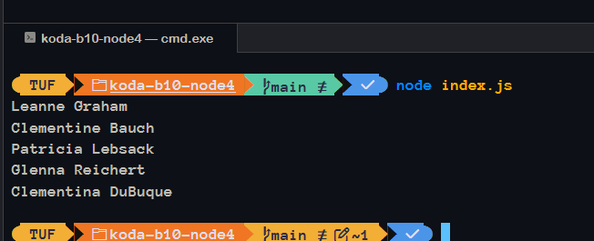

# JSDoc
on this repo i learn to use jsdoc to make the code be more verbose and type predictable
for this case i use data from jsonplaceholder then create the types def on `types/global.js`

### result

